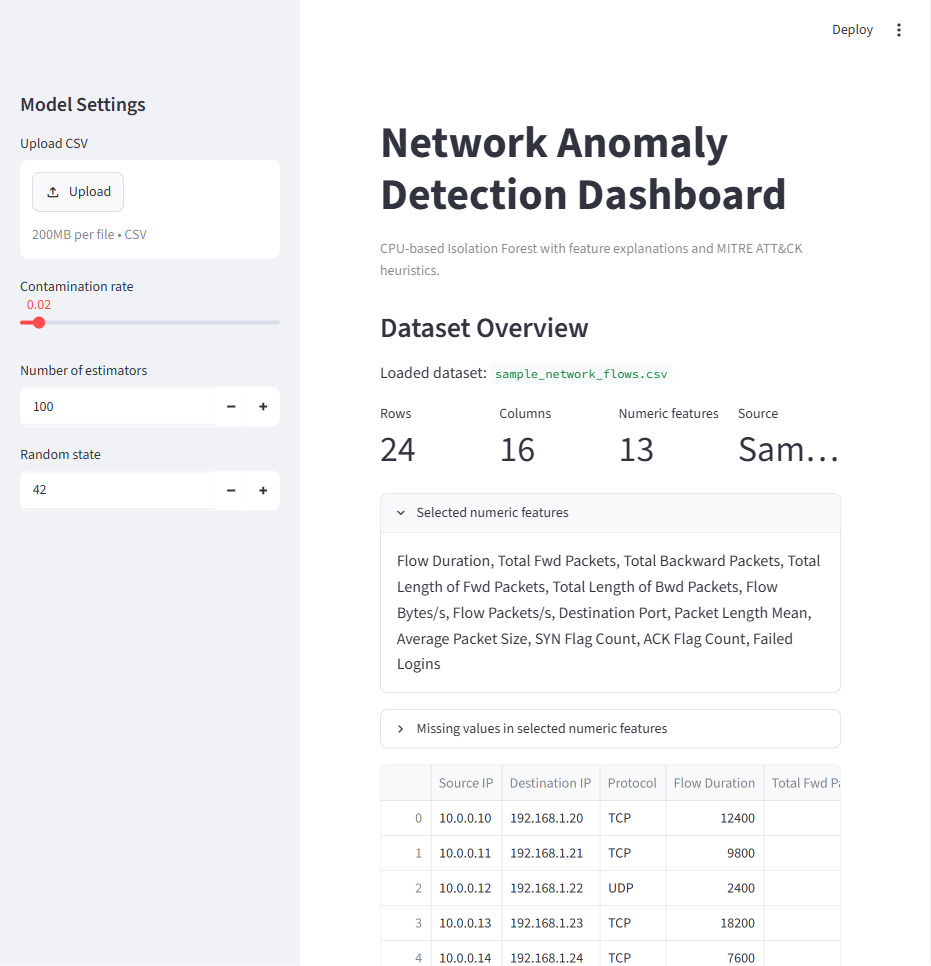

# CPU Network Anomaly Detection Dashboard

Streamlit MVP for detecting anomalous network traffic from CSV logs using a CPU-only Isolation Forest model. The dashboard highlights suspicious flows, explains unusual feature values, and maps simple traffic patterns to MITRE ATT&CK tactics and techniques.

## Project Goal

Security teams receive large volumes of network-flow logs. This project gives a lightweight local dashboard for finding suspicious flows and explaining why a row may be anomalous.

## Requirement Check

| Requirement | Where it is covered |
| --- | --- |
| Clear problem statement | Project goal and `REPORT.md` |
| Architecture | `REPORT.md` architecture section and modular files |
| Chosen technologies | Streamlit, pandas, scikit-learn, Plotly, and Python |
| Data analysis | Dataset overview, preprocessing, selected features, missing-value handling |
| Results | Detection metrics, suspicious-flow table, scatter plot, anomaly explanation |
| Conclusions | `REPORT.md` conclusion section |
| MITRE ATT&CK mapping | `mitre_mapping.py` and dashboard mapping table |
| Written report | `REPORT.md` |
| Short presentation/demo | `PRESENTATION.md` |
| CPU-only constraint | This README, `REPORT.md`, and dependency list |

## Install

Use Python 3.10 or newer.

```bash
python -m pip install -r requirements.txt
```

## Run

```bash
streamlit run app.py
```

The app loads `data/sample_network_flows.csv` when no file is uploaded. You can upload a custom CSV as long as it contains at least two numeric network-flow features.

## Dataset

The included sample CSV is synthetic but shaped like common CICIDS2017-style flow data. It contains normal web/DNS flows and a few suspicious examples such as rapid scanning, high-volume outbound transfer, flooding-like traffic, and repeated failed-login-like behavior.

Recommended numeric features include:

- Flow Duration
- Total Fwd Packets
- Total Backward Packets
- Total Length of Fwd Packets
- Total Length of Bwd Packets
- Flow Bytes/s
- Flow Packets/s
- Destination Port
- Packet Length Mean
- Average Packet Size
- SYN Flag Count
- ACK Flag Count

If some recommended columns are missing, the app automatically uses available numeric columns.

## Model

The MVP uses `sklearn.ensemble.IsolationForest`.

- Runs on CPU.
- Does not require labeled data.
- Produces `prediction = -1` for anomalies and `prediction = 1` for normal rows.
- Uses `decision_function` as the anomaly score.
- Lower anomaly scores are more suspicious.

## Dashboard Sections

- CSV upload or sample dataset fallback.
- Dataset overview with row count, column count, selected numeric features, missing-value summary, and preview.
- Model settings for contamination rate, estimator count, and random state.
- Detection summary metrics.
- Table of suspicious flows sorted by anomaly score.
- Plotly scatter plot for normal vs anomalous traffic.
- Selected anomaly explanation based on median comparisons.
- Simple MITRE ATT&CK heuristic mapping.

## Screenshots



The screenshot shows the dashboard loading the included sample dataset, selecting
numeric network-flow features, and preparing the anomaly detection workflow.

## Deliverables

- `README.md` - project setup and requirement mapping.
- `REPORT.md` - written project report.
- `PRESENTATION.md` - short presentation and demo outline.
- `screenshots/dashboard-overview.png` - dashboard screenshot for the demo.
- `tests/test_core.py` - core behavior tests for preprocessing, modeling,
  explanations, and MITRE mapping.

## Limitations

- The model is unsupervised and does not prove malicious activity.
- MITRE ATT&CK mapping is heuristic and intended for explanation, not formal attribution.
- Results depend on CSV quality and available numeric features.
- The sample dataset is small and synthetic.
- IP addresses and protocol fields are displayed but not modeled directly in this MVP.

## Future Improvements

- Add support for categorical feature encoding.
- Add saved model export with `joblib`.
- Add richer MITRE rules per protocol and port.
- Add downloadable results.
- Evaluate on CICIDS2017 or UNSW-NB15 samples.

## CPU-Only Constraint

This project intentionally uses standard Python data-science libraries only. It does not use GPU acceleration, CUDA, RAPIDS, cuDF, Triton, or NVIDIA-specific code.
